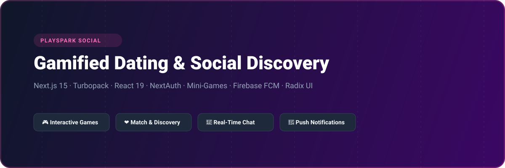
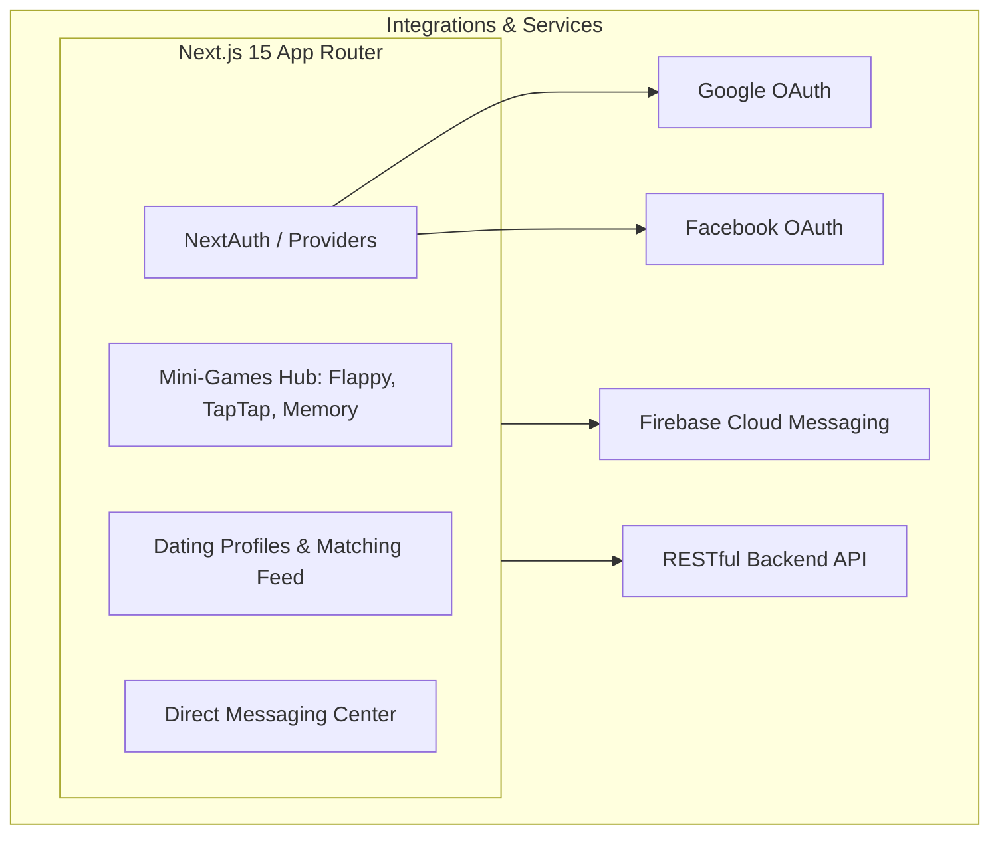

# PlaySpark - Gamified Dating & Social Discovery Web Platform

<p align="center">
  
</p>

<p align="center">
  <a href="https://nextjs.org"></a>
  <a href="https://react.dev"></a>
  <a href="https://next-auth.js.org"></a>
  <a href="https://firebase.google.com"></a>
  <a href="https://tailwindcss.com"></a>
  <a href="LICENSE"></a>
</p>

---

## 📖 Overview

**PlaySpark Frontend (`ericjohnson_frontend`)** is an innovative gamified dating and social networking web platform built with Next.js 15 (Turbopack) and React 19. Combining classic casual games with intelligent matchmaking algorithms, PlaySpark allows users to break the ice through interactive gameplay (Flappy Flight, Tap Tap Clash, Memory Match), match based on granular dating preferences, communicate in real time, and receive instant push notifications via Firebase Cloud Messaging.

---

## ⚡ Key Features

- **🎮 Embedded Interactive Mini-Games:** Built-in multiplayer and solo challenge games including:
  - *Flappy Flight*: Casual arcade flight obstacle challenge
  - *Tap Tap Clash*: High-speed reflex duel
  - *Memory Match*: Card-flip visual association puzzle
- **💖 Deep Onboarding & Preference Flow:** Guided wizard for specifying age brackets, dating orientation, relationship expectations, photo galleries, and access permissions.
- **💬 Direct Messaging & Chat:** Real-time conversation threads with matched profiles and unread message indicators.
- **🔐 Multi-Provider Authentication:** NextAuth integration supporting Google OAuth, Facebook Login, and email credentials with OTP recovery.
- **🔔 Firebase Web Push Alerts:** Background service worker notifications for new matches, messages, and game invites.

---

## 🏗️ System Architecture



---

## 🗂️ Project Structure

```
ericjohnson_frontend/
├── assets/
│   └── banner.svg               # Architectural repository banner
├── public/
│   └── firebase-messaging-sw.js # FCM background service worker
├── src/
│   ├── app/
│   │   ├── (games)/             # Flappy Flight, Tap Tap Clash, Memory Match
│   │   ├── (AuthLayout)/        # Login, Signup, Dating preferences onboarding
│   │   ├── (default)/           # Feed, Profiles, Direct messaging
│   │   ├── api/auth/            # NextAuth API endpoints
│   │   └── layout.tsx
│   ├── components/              # Game canvas components & UI dialogs
│   ├── lib/                     # Firebase and NextAuth configs
│   └── redux/                   # State slices & API client
├── package.json
└── tsconfig.json
```

---

## 🛠️ Tech Stack

| Technology | Purpose |
| :--- | :--- |
| **Next.js 15** | Server-rendered and client-side App Router with Turbopack |
| **React 19** | Component framework and state lifecycle |
| **NextAuth.js** | Authentication management (Google, Facebook, Credentials) |
| **Firebase FCM** | Web Push background alerts and notifications |
| **Tailwind CSS** | Neon-accented responsive styling |
| **Radix UI** | Accessible headless UI dialogs, popovers, and tabs |

---

## 🚀 Getting Started

### Prerequisites

- Node.js >= 20.0.0
- npm or yarn

### Installation

1. Clone the repository:
   ```bash
   git clone https://github.com/shahjalal-labs/ericjohnson_frontend.git
   cd ericjohnson_frontend
   ```

2. Install dependencies:
   ```bash
   npm install
   ```

3. Configure environment variables:
   ```bash
   cp .env.example .env.local
   ```

4. Start development server:
   ```bash
   npm run dev
   ```
   Open [http://localhost:3000](http://localhost:3000) to view the portal.

---

## 📄 License

This project is licensed under the [ISC License](LICENSE).
